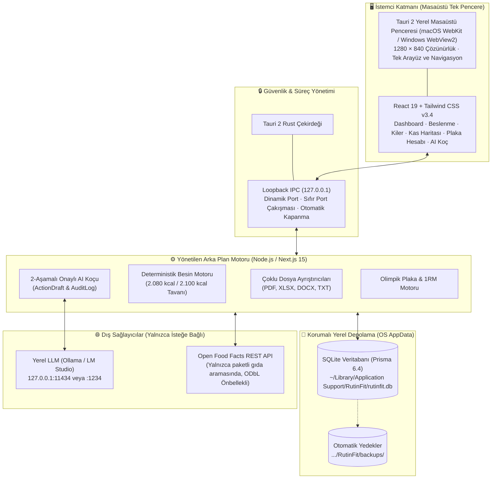
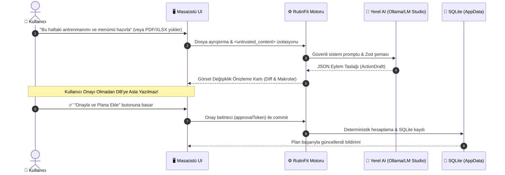

# 🏋️‍♂️ RutinFit Desktop

<p align="center">
  
</p>

<p align="center">
  <strong>Yoğun Çalışanlar İçin Tek Pencerede Çalışan, Gizlilik Odaklı Kişisel Fitness, Beslenme ve Ritim Asistanı</strong><br>
  <em>Tauri 2 · Next.js 15 · React 19 · Prisma SQLite · Yerel AI (Ollama & LM Studio) · Sıfır Docker Zorunluluğu</em>
</p>

<p align="center">
  <a href="tests/"></a>
  <a href="https://nextjs.org/"></a>
  <a href="https://tauri.app/"></a>
  <a href="https://www.prisma.io/"></a>
  <a href="LICENSE"></a>
</p>

---

## 🌟 Neden RutinFit Desktop?

Geleneksel fitness ve beslenme uygulamaları verilerinizi bulutta saklar, her özellik için ayrı bir web sekmesi veya karmaşık Docker servisleri (örn. openGym port 8080) çalıştırmanızı gerektirir. 

**RutinFit**, tüm bu karmaşayı tek bir hafif masaüstü penceresinde birleştirir:
* 🔒 **%100 Yerel-First ve Gizli:** Tüm sağlık, besin, kilo ve egzersiz kayıtlarınız yalnızca kendi bilgisayarınızda SQLite üzerinde tutulur.
* ⚡ **Tek Pencere Deneyimi:** OpenGym antrenman sistemi, interaktif kas haritası, plaka hesabı, kiler envanteri ve AI koçu aynı çatı altındadır; **iframe veya harici port sekmesi açılmaz**.
* 🚫 **Sıfır Docker Gereksinimi:** Son kullanıcının Docker, OrbStack veya port konfigürasyonuyla uğraşması gerekmez.
* 🧮 **Deterministik Matematik:** Kaloriler ve makrolar yapay zeka tahminleriyle değil, onaylı 100g gıda verileriyle kuruşu kuruşuna hesaplanır.
* 🛡️ **2-Aşamalı Onaylı Yerel AI:** Ollama veya LM Studio ile çevrimdışı çalışır; kullanıcı açıkça "Onayla" butonuna basmadan veritabanında hiçbir kayıt değişmez.

---

## 🏛️ Mimari Şema



---

## 📸 Görsel Özellik Vitrini (Feature Showcase)

### 1. 📊 Akıllı Beslenme, Ritim ve Kiler Yönetimi
> **2.080 kcal sakin hedef**, suçlayıcı olmayan 2.100 kcal üst tavanı, 4 öğünlük günlük yemek planı ve evdeki malzemeleri kilerde tutup eksikleri otomatik çıkaran alışveriş listesi.

```
┌────────────────────────────────────────────────────────────────────────┐
│ GÜNLÜK KALORİ & MAKRO HEDEFİ                                           │
├────────────────────────────────────────────────────────────────────────┤
│ Kalori:  1.420 / 2.080 kcal  [████████████████░░░░░░░░] %68 (Sakin Mod)│
│ Protein:   125 /   165 g     [███████████████████░░░░░] %75            │
│ Karb:      150 /   220 g     [██████████████░░░░░░░░░░] %68            │
│ Yağ:        42 /    60 g     [████████████████░░░░░░░░] %70            │
├────────────────────────────────────────────────────────────────────────┤
│ Porsiyon Çarpanları: [ 0.5x Yarım ]  [ 1.0x Standart ]  [ 1.5x Doyurucu]│
│ Kiler Farkı: 500g Yulaf Menüde - 300g Evde = 200g Alışveriş Listesinde │
└────────────────────────────────────────────────────────────────────────┘
```

---

### 2. 🧬 Kas Yorgunluk & Toparlanma Haritası (`<MuscleHeatmap />`)
> `abdofallah/MuscleMapJS` (MIT) ve Melih Çolpan'ın orijinal anatomik modelinden türetilen, **son 7 gündeki set hacminize göre** ön ve arka vücut kaslarını interaktif renklendiren SVG haritası.

```
┌───────────────────────────────────────┬────────────────────────────────┐
│  ÖN VÜCUT (Anterior)   ARKA (Posterior)│ SEÇİLİ KAS DETAYI: GÖĞÜS       │
│                                       ├────────────────────────────────┤
│         ( o )               ( o )     │ Pectoralis Major & Minor       │
│        /  |  \             /  |  \    │ Durum: Yüksek Yorgunluk 🔴     │
│       [ GÖĞÜS ]           [ SIRT  ]   │ Haftalık Hacim: 8 Set          │
│       [ KARIN ]           [ BEL   ]   │ Son Seans: Dün (19:40)         │
│       [ BACAK ]           [ KALÇA ]   │ Öneri: 48 saat dinlenme        │
│                                       │ Egzersizler: Bench Press, Dips │
├───────────────────────────────────────┴────────────────────────────────┤
│ Lejant:  🟢 Dinlenmiş (0-3 set)  🟡 Toparlanıyor (4-7)  🔴 Yorgun (8+)  │
└────────────────────────────────────────────────────────────────────────┘
```

---

### 3. 🏋️ Olimpik Bar & 1RM Plaka Hesaplayıcı (`<PlateCalculator />`)
> Hedef ağırlığa göre 20kg barın her iki tarafına takılması gereken plakaları renk kodlarıyla hesaplar ve bar manşonunu görsel olarak çizer.

```
┌────────────────────────────────────────────────────────────────────────┐
│ HEDEF AĞIRLIK: 100 kg   ·   BAR: 20 kg Olimpik Bar   ·   KLİPS: 0 kg   │
├────────────────────────────────────────────────────────────────────────┤
│ Her Tarafa Takılacak: 40 kg  ===>  [ 1 × 20kg 🟦 ] + [ 1 × 20kg 🟦 ]   │
│                                                                        │
│ BAR ===|===[ 20kg Mavi ]===[ 20kg Mavi ]===(Kilit)                     │
├────────────────────────────────────────────────────────────────────────┤
│ 1RM Formülü (Brzycki & Epley): 100 kg × 5 tekrar ===> Tahmini 1RM: 115kg│
│ Çalışma Yüzdeleri: %90 = 102.5kg  ·  %85 = 97.5kg  ·  %80 = 92.5kg     │
└────────────────────────────────────────────────────────────────────────┘
```

---

### 4. 🤖 Güvenli İki Aşamalı AI Planlama Döngüsü



---

## 📚 Açık Kaynak Repolar ve Yasal Atıf Tablosu

RutinFit, açık kaynak ekosistemine saygı duyar ve tüm kaynakları doğrulanmış lisanslarıyla açıkça listeler:

| Proje / Kaynak | Doğrulanmış Lisans | Kullanım Durumu | RutinFit'teki Kesin Rolü |
|---|---|---|---|
| **openGym**<br>[GitHub](https://github.com/DuarteSantos8/openGym) · [Gitea](https://gitea.com/DuarteSantos/openGym) | **AGPL-3.0**<br>(Görseller: **Gym Visual** Telifli) | **`adapted`** | Egzersiz ve set/rep veri modelleri yerel SQLite şemamıza uyarlandı. AGPL copyleft ve telifli görsel riskleri nedeniyle web kodu kopyalanmadı. |
| **Open Food Facts**<br>[GitHub](https://github.com/openfoodfacts/openfoodfacts-server) | Sunucu: **AGPL-3.0**<br>DB: **ODbL 1.0**<br>Görseller: **CC BY-SA** | **`external API`** | Paketli gıda ve barkod arama istemcisi (`openfoodfacts-client.ts`). SQLite önbellek katmanı ve ODbL atıfı eklendi. |
| **Tally**<br>[GitHub](https://github.com/GeneArnold/tally) | **MIT**<br>(Telif: 2026 Gene Arnold) | **`adapted`** | Ergonomik porsiyon çarpanları (`0.5x`, `1.0x`, `1.5x`) ve anlık makro geri bildirim UX kalıpları uyarlandı. |
| **Pantry Host**<br>[GitHub](https://github.com/jpdevries/pantry-host) | **MIT**<br>(Telif: 2026 JP de Vries) | **`adapted`** | Kiler envanteri (`PantryItem`) ve tariflerden net alışveriş listesi çıkarma mantığı uyarlandı. Anthropic çağrısı yerel AI ile değiştirildi. |
| **Diet App**<br>[GitHub](https://github.com/whiteravens20/diet-app) | **AGPL-3.0** | **`reference only`** | Hedefe göre menü planlama konsepti kavramsal incelendi. AGPL lisansı nedeniyle hiçbir kaynak kod kopyalanmadı. |
| **Meals**<br>[GitHub](https://github.com/marco308/meals) | Çekirdek: **AGPL-3.0** | **`deferred`** | AI araçları ve MCP mimarisi incelendi. RutinFit'in kendi 2-aşamalı onaylı motoru daha güvenli olduğu için kod birleştirmesi yapılmadı. |
| **MuscleMapJS**<br>[GitHub](https://github.com/abdofallah/MuscleMapJS) | **MIT**<br>(Melih Çolpan türevi) | **`adopted`** | Ön ve arka vücut interaktif SVG kas yorgunluk haritası (`src/components/MuscleHeatmap.tsx`) olarak uyarlandı. |
| **MuscleMap SwiftUI SDK**<br>[GitHub](https://github.com/MuscleMap/MuscleMap) | **MIT**<br>(Telif: Melih Çolpan) | **`reference only`** | MuscleMapJS'in orijinal iOS kaynak projesi; anatomik gruplama referansı ve lisans atfı olarak belgelendi. |

Ayrıntılı teknik analizler ve raporlar için:
* 🏛️ [**Mimari Kararlar ve Teknoloji Yığını Kılavuzu**](docs/ARCHITECTURE_AND_TECH_STACK.md)
* 🔬 [**Açık Kaynak Repolar ve Entegrasyon Derinlemesine İnceleme**](docs/OPEN_SOURCE_INTEGRATION_DEEP_DIVE.md)
* 🧪 [**Mimari Doğrulama ve Test Raporu (Walkthrough)**](docs/WALKTHROUGH.md)
* 📋 [`docs/OPEN_SOURCE_COMPONENTS.md`](docs/OPEN_SOURCE_COMPONENTS.md)
* ⚖️ [`THIRD_PARTY_NOTICES.md`](THIRD_PARTY_NOTICES.md)

---

## 🚀 Hızlı Başlangıç & Kurulum

### Gereksinimler
* **Node.js:** v20+ (Node v22.18+ önerilir)
* **Paket Yöneticisi:** `pnpm` (`npm install -g pnpm`)
* **Rust & Cargo:** v1.80+ (Tauri 2 masaüstü derleyicisi için)
* *(İsteğe bağlı)* **Yerel AI:** [Ollama](https://ollama.com) veya [LM Studio](https://lmstudio.ai)
* **ÖNEMLİ:** Son kullanıcının **Docker kurması zorunlu DEĞİLDİR**.

### 1. Kurulum ve Veritabanı
```bash
# Depoyu klonlayın
git clone https://github.com/memirutku/rutinfit.git
cd rutinfit

# Bağımlılıkları yükleyin
pnpm install

# Yerel veritabanını oluşturun ve şablon verileri yükleyin
pnpm run db:push
pnpm run db:seed
```

### 2. Testleri Çalıştırma
```bash
pnpm test
```
> 10 test dosyasında 38 birim/entegrasyon testi 700ms içinde %100 başarıyla tamamlanır.

### 3. Uygulamayı Başlatma
* **Masaüstü Uygulaması (Tauri 2):**
  ```bash
  pnpm run desktop:dev
  ```
* **Web Tarayıcısı Modu:**
  ```bash
  pnpm dev -p 3005
  ```
  Tarayıcınızda açın: `http://localhost:3005`

---

## 🤖 Yerel Yapay Zeka Bağlantısı (Ollama & LM Studio)

RutinFit, kişisel verilerinizi asla harici bir bulut sunucusuna göndermez:

1. **Ollama ile:**
   ```bash
   ollama run llama3.2
   ```
   RutinFit içindeki **Ayarlar** sekmesinde Sağlayıcı olarak `Ollama` (`http://127.0.0.1:11434/v1`) ve Model olarak `llama3.2` seçip **"Bağlantıyı Test Et"** butonuna basın.
2. **LM Studio ile:**
   * LM Studio'yu açın, **Developer / Local Server** sekmesinden sunucuyu başlatın (`http://127.0.0.1:1234/v1`).
   * RutinFit **Ayarlar** sekmesinde Sağlayıcı olarak `LM Studio` seçin.

---

## 🤝 Katkıda Bulunma (Contributing)

Katkıda bulunmak isteyen herkesi memnuniyetle karşılıyoruz! Lütfen önce [Katkıda Bulunma Rehberi'ni (CONTRIBUTING.md)](CONTRIBUTING.md) ve [Davranış Kuralları'nı (CODE_OF_CONDUCT.md)](CODE_OF_CONDUCT.md) inceleyiniz.

---

## 📄 Lisans

RutinFit, **[MIT Lisansı](LICENSE)** altında açık kaynak olarak dağıtılmaktadır.  
Telif Hakkı (c) 2026 RutinFit Katkıda Bulunanları.
