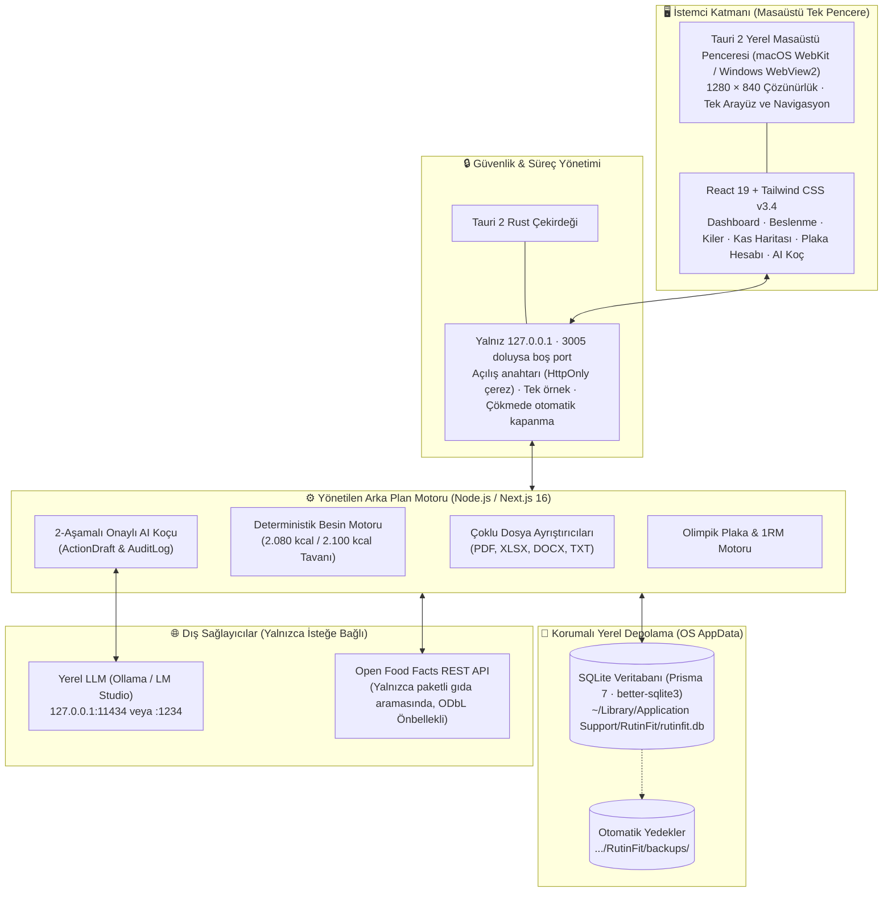
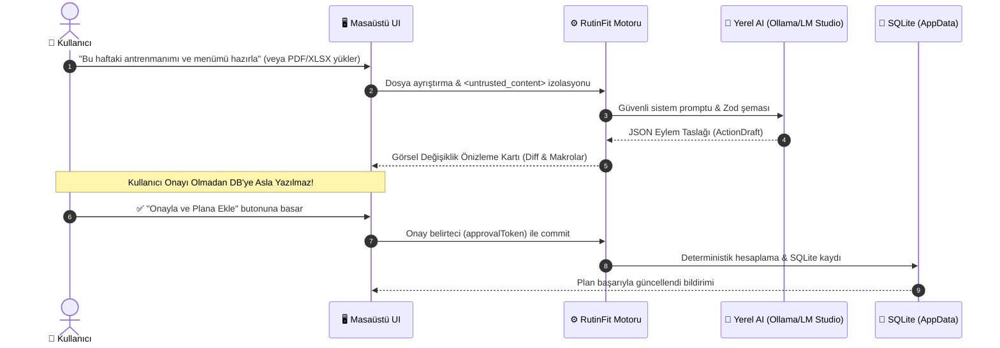

# 🏋️‍♂️ RutinFit Desktop

<p align="center">
  
</p>

<p align="center">
  <strong>Yoğun Çalışanlar İçin Tek Pencerede Çalışan, Gizlilik Odaklı Kişisel Fitness, Beslenme ve Ritim Asistanı</strong><br>
  <em>Tauri 2 · Next.js 16 · React 19 · Prisma 7 SQLite · Yerel AI (Ollama & LM Studio) · Sıfır Docker Zorunluluğu</em>
</p>

<p align="center">
  <a href="https://github.com/memirutku/rutinfit/actions/workflows/ci.yml"></a>
  <a href="tests/"></a>
  <a href="https://nextjs.org/"></a>
  <a href="https://tauri.app/"></a>
  <a href="https://www.prisma.io/"></a>
  <a href="LICENSE"></a>
</p>

---

## 🌟 Neden RutinFit Desktop?

Geleneksel fitness ve beslenme uygulamaları verilerinizi bulutta saklar, her özellik için ayrı bir web sekmesi veya karmaşık Docker servisleri (örn. openGym port 8080) çalıştırmanızı gerektirir. 

**RutinFit**, tüm bu karmaşayı tek bir hafif masaüstü penceresinde birleştirir:
* 🔒 **%100 Yerel-First ve Gizli:** Tüm sağlık, besin, kilo ve egzersiz kayıtlarınız yalnızca kendi bilgisayarınızda SQLite üzerinde tutulur.
* ⚡ **Tek Pencere Deneyimi:** OpenGym antrenman sistemi, interaktif kas haritası, plaka hesabı, kiler envanteri ve AI koçu aynı çatı altındadır; **iframe veya harici port sekmesi açılmaz**.
* 🚫 **Sıfır Docker Gereksinimi:** Son kullanıcının Docker, OrbStack veya port konfigürasyonuyla uğraşması gerekmez.
* 🧮 **Deterministik Matematik:** Kaloriler ve makrolar yapay zeka tahminleriyle değil, onaylı 100g gıda verileriyle kuruşu kuruşuna hesaplanır.
* 🛡️ **2-Aşamalı Onaylı Yerel AI:** Ollama veya LM Studio ile çevrimdışı çalışır; kullanıcı açıkça "Onayla" butonuna basmadan veritabanında hiçbir kayıt değişmez.
* ⏱️ **Günün Ritmi & Kolay Kullanım:** Eve varış saatinize duyarlı ritim çizelgesi, son kullanılan besinler, 7 saniyelik geri alma (Undo) ve otomatik dinlenme sayaçlı set takibi.

---

## 🚦 Özellik Durum Matrisi (Feature Status Matrix)

RutinFit'in tüm yetenekleri gerçek kod tabanı ve testlerle doğrulanmış 3 net seviyede sınıflandırılır:

| Modül | Özellik | Durum | Açıklama |
|---|---|:---:|---|
| **Beslenme & Kiler** | 2.080 kcal Sakin Hedef & 2.100 kcal Üst Sınır Uyarısı | 🟢 **Hazır** | Suçlayıcı olmayan bildirimler, deterministik makro dağılımı. |
| **Beslenme & Kiler** | Hızlı Öğün Kaydı, Son Kullanılanlar & Geri Alma (Undo) | 🟢 **Hazır** | Tek tıkla besin seçimi, LIFO 5 öğeli geçmiş ve 7s geri alma toast'ı. |
| **Beslenme & Kiler** | Kiler Envanteri & Eksiklerden Otomatik Alışveriş Listesi | 🟢 **Hazır** | Kilerdeki gramajı menüden düşüp yalnızca net eksiği listeleme. |
| **Beslenme & Kiler** | Open Food Facts Paketli Gıda Arama & Önbellek | 🟡 **Beta** | ODbL uyumlu SQLite önbellek istemcisi (`openfoodfacts-client.ts`). |
| **Antrenman & Vücut** | İnteraktif SVG Kas Haritası (`MuscleHeatmap`) | 🟢 **Hazır** | Son 7 gündeki set hacmine göre ön ve arka kasları renklendirme. |
| **Antrenman & Vücut** | Olimpik Bar & 1RM Plaka Hesaplayıcı (`PlateCalculator`) | 🟢 **Hazır** | 20kg bar manşon çizimi ve Brzycki/Epley 1RM formülleri. |
| **Antrenman & Vücut** | Set Tamamlama, Dinlenme Sayacı & Kaldığın Yerden Devam | 🟢 **Hazır** | Otomatik geri sayım sayacı, yerel draft kurtarma (`localStorage`). |
| **Antrenman & Vücut** | openGym İsteğe Bağlı Sidecar Entegrasyonu | 🟡 **Beta** | Docker gerektirmeyen bağımsız veri modeli ve dışa aktarım köprüsü. |
| **Yerel AI & Ritim** | Günün Sıradaki Adımı / Ritim Çizelgesi | 🟢 **Hazır** | Sabah hidrasyonu, öğle beslenmesi, 19:40 iş çıkışı ve uyku adımları. |
| **Yerel AI & Ritim** | 2-Aşamalı Onaylı Yerel AI Koçu (Ollama / LM Studio) | 🟢 **Hazır** | `ActionDraft` ve `AuditLog` ile kullanıcı onayı olmadan DB'ye yazmama. |
| **Yerel AI & Ritim** | Güvenli Çoklu Dosya Ayrıştırıcıları (PDF, XLSX, DOCX, TXT) | 🟢 **Hazır** | `<untrusted_content>` izolasyonu ve Zod doğrulaması. |
| **Sistem & Veri** | Tam Kapsamlı Yedekleme & Geri Yükleme (v2) | 🟢 **Hazır** | Önbellek dışındaki tüm tablolar; satır satır doğrulama, tek transaction, binlerce kayıtta toplu yazma. 1.x yedekleri de okunur. |
| **Sistem & Veri** | Canlı Sistem Tanılama & Performans Ekranı | 🟢 **Hazır** | SQLite dosya boyutu, RSS bellek ve çalışma süresi izleme. |
| **Masaüstü Dağıtımı** | Tauri 2 Masaüstü Uygulaması (`pnpm desktop:build`) | 🟡 **Beta** | Gömülü Node 22 + Next.js standalone sunucu; proje klasörü veya pnpm gerektirmeyen `.app` / `.dmg` (macOS, imzasız yerel derleme). |
| **Masaüstü Dağıtımı** | İmzalı Tek Tıkla Kurulum Paketleri (`.dmg`, `.msi`, `.deb`) | 🔵 **Planlanıyor** | GitHub Releases üzerinden imzalı bağımsız kurulum dosyaları. |
| **Mobil / Donanım** | Apple Health / Health Connect Dışa Aktarımı | 🔵 **Planlanıyor** | Akıllı saat ve sağlık verisi senkronizasyon köprüsü. |

---

## 🏛️ Mimari Şema



---

## 📸 Görsel Özellik Vitrini (Feature Showcase)

### 1. 📊 Akıllı Beslenme, Ritim ve Kiler Yönetimi
> **2.080 kcal sakin hedef**, suçlayıcı olmayan 2.100 kcal üst tavanı, 4 öğünlük günlük yemek planı ve evdeki malzemeleri kilerde tutup eksikleri otomatik çıkaran alışveriş listesi.

```
┌────────────────────────────────────────────────────────────────────────┐
│ GÜNLÜK KALORİ & MAKRO HEDEFİ                                           │
├────────────────────────────────────────────────────────────────────────┤
│ Kalori:  1.420 / 2.080 kcal  [████████████████░░░░░░░░] %68 (Sakin Mod)│
│ Protein:   125 /   165 g     [███████████████████░░░░░] %75            │
│ Karb:      150 /   220 g     [██████████████░░░░░░░░░░] %68            │
│ Yağ:        42 /    60 g     [████████████████░░░░░░░░] %70            │
├────────────────────────────────────────────────────────────────────────┤
│ Porsiyon Çarpanları: [ 0.5x Yarım ]  [ 1.0x Standart ]  [ 1.5x Doyurucu]│
│ Kiler Farkı: 500g Yulaf Menüde - 300g Evde = 200g Alışveriş Listesinde │
└────────────────────────────────────────────────────────────────────────┘
```

---

### 2. 🧬 Kas Yorgunluk & Toparlanma Haritası (`<MuscleHeatmap />`)
> `abdofallah/MuscleMapJS` (MIT) ve Melih Çolpan'ın orijinal anatomik modelinden türetilen, **son 7 gündeki set hacminize göre** ön ve arka vücut kaslarını interaktif renklendiren SVG haritası.

```
┌───────────────────────────────────────┬────────────────────────────────┐
│  ÖN VÜCUT (Anterior)   ARKA (Posterior)│ SEÇİLİ KAS DETAYI: GÖĞÜS       │
│                                       ├────────────────────────────────┤
│         ( o )               ( o )     │ Pectoralis Major & Minor       │
│        /  |  \             /  |  \    │ Durum: Yüksek Yorgunluk 🔴     │
│       [ GÖĞÜS ]           [ SIRT  ]   │ Haftalık Hacim: 8 Set          │
│       [ KARIN ]           [ BEL   ]   │ Son Seans: Dün (19:40)         │
│       [ BACAK ]           [ KALÇA ]   │ Öneri: 48 saat dinlenme        │
│                                       │ Egzersizler: Bench Press, Dips │
├───────────────────────────────────────┴────────────────────────────────┤
│ Lejant:  🟢 Dinlenmiş (0-3 set)  🟡 Toparlanıyor (4-7)  🔴 Yorgun (8+)  │
└────────────────────────────────────────────────────────────────────────┘
```

---

### 3. 🏋️ Olimpik Bar & 1RM Plaka Hesaplayıcı (`<PlateCalculator />`)
> Hedef ağırlığa göre 20kg barın her iki tarafına takılması gereken plakaları renk kodlarıyla hesaplar ve bar manşonunu görsel olarak çizer.

```
┌────────────────────────────────────────────────────────────────────────┐
│ HEDEF AĞIRLIK: 100 kg   ·   BAR: 20 kg Olimpik Bar   ·   KLİPS: 0 kg   │
├────────────────────────────────────────────────────────────────────────┤
│ Her Tarafa Takılacak: 40 kg  ===>  [ 1 × 20kg 🟦 ] + [ 1 × 20kg 🟦 ]   │
│                                                                        │
│ BAR ===|===[ 20kg Mavi ]===[ 20kg Mavi ]===(Kilit)                     │
├────────────────────────────────────────────────────────────────────────┤
│ 1RM Formülü (Brzycki & Epley): 100 kg × 5 tekrar ===> Tahmini 1RM: 115kg│
│ Çalışma Yüzdeleri: %90 = 102.5kg  ·  %85 = 97.5kg  ·  %80 = 92.5kg     │
└────────────────────────────────────────────────────────────────────────┘
```

---

### 4. 🤖 Güvenli İki Aşamalı AI Planlama Döngüsü



---

## 📚 Açık Kaynak Repolar ve Yasal Atıf Tablosu

RutinFit, açık kaynak ekosistemine saygı duyar ve tüm kaynakları doğrulanmış lisanslarıyla açıkça listeler:

| Proje / Kaynak | Doğrulanmış Lisans | Kullanım Durumu | RutinFit'teki Kesin Rolü |
|---|---|---|---|
| **openGym**<br>[GitHub](https://github.com/DuarteSantos8/openGym) · [Gitea](https://gitea.com/DuarteSantos/openGym) | **AGPL-3.0**<br>(Görseller: **Gym Visual** Telifli) | **`adapted`** | Egzersiz ve set/rep veri modelleri yerel SQLite şemamıza uyarlandı. AGPL copyleft ve telifli görsel riskleri nedeniyle web kodu kopyalanmadı. |
| **Open Food Facts**<br>[GitHub](https://github.com/openfoodfacts/openfoodfacts-server) | Sunucu: **AGPL-3.0**<br>DB: **ODbL 1.0**<br>Görseller: **CC BY-SA** | **`external API`** | Paketli gıda ve barkod arama istemcisi (`openfoodfacts-client.ts`). SQLite önbellek katmanı ve ODbL atıfı eklendi. |
| **Tally**<br>[GitHub](https://github.com/GeneArnold/tally) | **MIT**<br>(Telif: 2026 Gene Arnold) | **`adapted`** | Ergonomik porsiyon çarpanları (`0.5x`, `1.0x`, `1.5x`) ve anlık makro geri bildirim UX kalıpları uyarlandı. |
| **Pantry Host**<br>[GitHub](https://github.com/jpdevries/pantry-host) | **MIT**<br>(Telif: 2026 JP de Vries) | **`adapted`** | Kiler envanteri (`PantryItem`) ve tariflerden net alışveriş listesi çıkarma mantığı uyarlandı. Anthropic çağrısı yerel AI ile değiştirildi. |
| **Diet App**<br>[GitHub](https://github.com/whiteravens20/diet-app) | **AGPL-3.0** | **`reference only`** | Hedefe göre menü planlama konsepti kavramsal incelendi. AGPL lisansı nedeniyle hiçbir kaynak kod kopyalanmadı. |
| **Meals**<br>[GitHub](https://github.com/marco308/meals) | Çekirdek: **AGPL-3.0** | **`deferred`** | AI araçları ve MCP mimarisi incelendi. RutinFit'in kendi 2-aşamalı onaylı motoru daha güvenli olduğu için kod birleştirmesi yapılmadı. |
| **MuscleMapJS**<br>[GitHub](https://github.com/abdofallah/MuscleMapJS) | **MIT**<br>(Melih Çolpan türevi) | **`adopted`** | Ön ve arka vücut interaktif SVG kas yorgunluk haritası (`src/components/MuscleHeatmap.tsx`) olarak uyarlandı. |
| **MuscleMap SwiftUI SDK**<br>[GitHub](https://github.com/MuscleMap/MuscleMap) | **MIT**<br>(Telif: Melih Çolpan) | **`reference only`** | MuscleMapJS'in orijinal iOS kaynak projesi; anatomik gruplama referansı ve lisans atfı olarak belgelendi. |

Ayrıntılı teknik analizler ve raporlar için:
* 🏛️ [**Mimari Kararlar ve Teknoloji Yığını Kılavuzu**](docs/ARCHITECTURE_AND_TECH_STACK.md)
* 🔬 [**Açık Kaynak Repolar ve Entegrasyon Derinlemesine İnceleme**](docs/OPEN_SOURCE_INTEGRATION_DEEP_DIVE.md)
* 🧪 [**Mimari Doğrulama ve Test Raporu (Walkthrough)**](docs/WALKTHROUGH.md)
* 📋 [`docs/OPEN_SOURCE_COMPONENTS.md`](docs/OPEN_SOURCE_COMPONENTS.md)
* ⚖️ [`THIRD_PARTY_NOTICES.md`](THIRD_PARTY_NOTICES.md)

---

## 🚀 Kurulum ve Çalıştırma

> [!NOTE]
> **Son Kullanıcı / Dağıtım Durumu Bildirimi:**  
> RutinFit şu an aktif açık kaynak geliştirici önizleme aşamasındadır. Önceden derlenmiş tek tıkla kurulan `.dmg` veya `.msi` yükleyicileri henüz GitHub Releases'da yayınlanmamıştır; mevcut aşamada Node.js ve pnpm ile kaynak koddan çalıştırılmaktadır.

### 💻 Geliştirici Kurulumu

#### Sistem Gereksinimleri
* **İşletim Sistemi:** macOS (Apple Silicon veya Intel), Windows 10/11 (WebView2 ile) veya Linux (Ubuntu 22.04+)
* **Node.js:** v22 LTS (≥ 22.12). `pnpm install` Node 22 ile çalıştırılmalıdır: SQLite yerel eklentisi (better-sqlite3) kurulumdaki Node sürümüne göre derlenir ve masaüstü paketindeki gömülü Node da 22'dir.
* **Paket Yöneticisi:** `pnpm` v11 (`corepack enable`; sürüm `package.json` içinde sabitlenmiştir)
* **Rust & Cargo:** v1.80+ (Tauri 2 masaüstü derleyicisi için zorunludur)
* *(İsteğe bağlı)* **Yerel AI:** [Ollama](https://ollama.com) veya [LM Studio](https://lmstudio.ai)
* **ÖNEMLİ:** Docker veya harici port yapılandırması kurmanız **gerekmez**.

#### 1. Depoyu Klonlama ve Bağımlılıkları Yükleme
```bash
git clone https://github.com/memirutku/rutinfit.git
cd rutinfit

# Bağımlılıkları yükleyin (postinstall, Prisma istemcisini src/generated/ altına üretir)
pnpm install
```
`src/generated/` git'e girmez; şemayı değiştirdikten sonra `pnpm exec prisma generate` ile yeniden üretilir.

#### 2. Yerel Veritabanını Başlatma
```bash
# Şema migration'larını uygulama veritabanına uygular ve başlangıç verilerini yükler
pnpm db:seed
```
Uygulama veritabanı işletim sisteminin veri klasöründedir (macOS: `~/Library/Application Support/RutinFit/rutinfit.db`).
Sunucu her açılışta bekleyen migration'ları kendisi uygular; uygulamadan önce otomatik yedek alır (`backups/rutinfit_pre-migration_*.db`).

**Şema değişikliği yaparken:**
```bash
# 1. prisma/schema.prisma dosyasını düzenleyin
# 2. Farktan yeni migration üretin ve gözden geçirin
pnpm db:new-migration kisa_aciklama
# 3. Kendi veritabanınıza uygulayın (sunucu açılışında da otomatik uygulanır)
pnpm db:migrate
```
Migration eklemeden şemayı değiştirirseniz `pnpm test` içindeki drift testi başarısız olur.

#### 3. Testler
```bash
pnpm test              # birim + API entegrasyon + arayüz bileşen testleri (her dosya kendi geçici veritabanında)
pnpm test:coverage     # aynısı + kapsam raporu (coverage/index.html) ve eşik denetimi
pnpm test:e2e          # üretim derlemesi + Playwright uçtan uca testleri (Chromium ve WebKit)
pnpm exec tsc --noEmit # TypeScript tür denetimi
pnpm lint              # ESLint
```
Testler gerçek veritabanınıza **hiçbir zaman** yazmaz; yerel AI ve Open Food Facts çağrıları sahte sunucularla taklit edilir.

#### 4. Uygulamayı Başlatma
* **Web tarayıcısı geliştirici modu:**
  ```bash
  pnpm dev -p 3005
  ```
  Tarayıcınızda açın: `http://127.0.0.1:3005` (sunucu yalnız bu bilgisayardan erişilebilir).
* **Masaüstü penceresi (geliştirici modu):**
  ```bash
  pnpm desktop:dev
  ```
* **Masaüstü uygulaması (.app / .dmg):**
  ```bash
  pnpm desktop:build
  ```
  `next build` sonrası `scripts/prepare-desktop.mjs` sunucuyu `src-tauri/resources/server` klasörüne kopyalar
  (yalnız izin listesindeki girdiler: `server.js`, `package.json`, `.next`, `node_modules`, `prisma/migrations`),
  pakette kullanıcı verisi veya gizli dosya olmadığını doğrular, Node 22 çalışma zamanını
  (sabit sürüm, SHA-256 doğrulamalı) `src-tauri/binaries/` altına indirir ve SQLite yerel eklentisinin
  bu Node ile yüklendiğini, PDF'den metin çıkarmanın da bu Node ile paketteki dosyalarla çalıştığını denetler.
  Çıktı: `src-tauri/target/release/bundle/` (`macos/RutinFit.app`, `dmg/RutinFit_*.dmg`). Paketler şu an imzasızdır.

#### 5. Çatı Sürümleri ve Yükseltme Notları
Next.js 16.4, Prisma 7.10 ve Vitest 5.0 kullanılır (Ekim 2026'da 15.5 / 6.19 / 4.1'den yükseltildi; her biri ayrı commit).

**Next.js 16**
* `src/middleware.ts` → `src/proxy.ts` (`export function proxy`). Proxy her zaman Node.js'te çalışır; `config.runtime` verilemez.
* Turbopack hem `next dev` hem `next build` için varsayılan; eski webpack ayarı (`chunkLoadTimeout`) kaldırıldı.
* ESLint: `eslint-config-next` doğrudan flat config. React Compiler kuralları (`react-hooks/set-state-in-effect`, `immutability`, `refs`, `purity`) şimdilik **uyarı**; 13 mevcut kalıp ayrı bir işte düzeltilecek.
* `next dev` depoya `AGENTS.md` yazmasın diye `agentRules: false`. Sürüme uygun belgeler: `node_modules/next/dist/docs/`.
* Açılış anahtarı akışı meta-refresh ile kalır: 16.4'te de `req.url` Host `127.0.0.1` iken `localhost` taşıyor; göreli `Location` 500 veriyor (ölçüldü).

**Kullanıcı verisi pakete girmesin (Turbopack kuralı)**
* Turbopack, kullanıcı verisine giden dinamik `fs` / `path` çağrılarını izleyip dosyaları standalone çıktıya katar (sahte dosyalarla ölçüldü: `backups/*.db`, `uploads/*`, adında `_` geçen notlar). `outputFileTracingExcludes` yalnız sayfa/route izlerine uygulanır, `instrumentation` izine uygulanmaz.
* Bu yüzden kullanıcı veri klasörüne giden her çağrıya `/*turbopackIgnore: true*/` eklenir (bkz. `src/lib/storage-paths.ts`). Yeni kod da aynı kuralı izler: `pnpm build` çıktısında **"Dynamic filesystem access" uyarısı olmamalı**.
* İkinci güvence `scripts/prepare-desktop.mjs`: izin listesi dışındaki her şey pakete alınmaz ve doğrulamada hata sayılır.

**Prisma 7**
* Rust sorgu motoru yok; SQLite'a `@prisma/adapter-better-sqlite3` ile bağlanılır. Masaüstü paketinde `libquery_engine` kalmadı (`.app` 203 MB → 175 MB).
* İstemci yalnız `src/lib/db/client.ts` → `createPrismaClient()` ile oluşturulur. `timestampFormat: "unixepoch-ms"` zorunludur: Prisma 6 DateTime alanlarını INTEGER milisaniye olarak yazıyordu; mevcut veritabanları bu biçimde (`tests/db-adapter-compat.test.ts` korur).
* İstemci `prisma-client` üreteciyle `src/generated/prisma`'ya üretilir; `Prisma.dmmf` artık yok, yedekleme servisi alan bilgisini `src/generated/datamodel.ts`'ten okur (`prisma/generators/datamodel.mjs`).
* SQLite'ta sorgu başına en çok 999 parametre gönderilir ve `notIn` listeleri bölünmez (P2029). Büyük olabilecek listelerde `notIn` yerine önce okuyup `in` ile parça parça işleyin.
* Bağlantı adresi şemada değil `prisma.config.ts`'te (yalnız CLI). `migrate diff`: `--to-schema` ve gölge veritabanı `SHADOW_DATABASE_URL` ile.

**Vitest 5**
* Vite 8 artık açık bağımlılık; yapılandırma `vitest.config.mts` (ESM), JSX dönüşümü `oxc` ile.
* Yeni varsayılanlar (`clearMocks: true`, satır içi projelerde ortak Vite sunucusu) test değişikliği gerektirmedi.

**PDF ayrıştırma paketli sunucuda (pdf-parse)**
* `pdf-parse` (içinde pdfjs) `serverExternalPackages`'ta. Turbopack onu sunucu parçasına gömünce `@napi-rs/canvas`'ı (`createRequire(__filename)`) ve `./pdf.worker.mjs`'i (kendi klasörüne göreli) bulamıyordu: standalone sunucuda ve masaüstü uygulamasında PDF'den metin çıkmıyordu (Next 15'te "Setting up fake worker failed", Next 16'da "DOMMatrix is not defined"). Düz Node'da çalıştığı için birim testleri bunu yakalamıyordu.
* Dosya izleyicinin göremediği bu iki parça `outputFileTracingIncludes` ile `/api/files/upload` izine eklenir. `@napi-rs/canvas*` platforma özgü yerel eklentiyi de kapsar (macOS arm64: `skia.darwin-arm64.node`, 23 MB).
* Korumalar: `e2e/files-upload.spec.ts` standalone sunucuya PDF yükleyip çıkan metni bekler; `scripts/prepare-desktop.mjs` paketteki pdf-parse'ı gömülü Node ile çalıştırır ve paket dışından modül yüklenirse derlemeyi durdurur.

---

---

## 🤖 Yerel Yapay Zeka Bağlantısı (Ollama & LM Studio)

RutinFit, kişisel sağlık ve besin verilerinizi asla harici bir bulut sunucusuna göndermez. Gizlilik için yapay zekâ adresi yalnız bu bilgisayardaki bir sunucu (`127.0.0.1` / `localhost`) veya resmi `https://api.openai.com` olabilir; ayar yalnız bağlantı testi başarılıysa kaydedilir:

1. **Ollama ile:**
   ```bash
   ollama run llama3.2
   ```
   RutinFit içindeki **Ayarlar** sekmesinde Sağlayıcı olarak `Ollama` (`http://127.0.0.1:11434/v1`) ve Model olarak `llama3.2` seçip **"Bağlantıyı Test Et"** butonuna basın.
2. **LM Studio ile:**
   * LM Studio'yu açın, **Developer / Local Server** sekmesinden sunucuyu başlatın (`http://127.0.0.1:1234/v1`).
   * RutinFit **Ayarlar** sekmesinde Sağlayıcı olarak `LM Studio` seçin.

---

## 🛡️ Güvenlik Politikası ve Desteklenen Platformlar

* **Ağ erişimi:** Sunucu yalnız `127.0.0.1` adresini dinler. API istekleri Host başlığına (DNS rebinding), `Sec-Fetch-Site`/`Origin` başlıklarına (başka sitelerden gelen istekler) göre süzülür; masaüstü uygulamasında ayrıca her açılışta üretilen bir anahtarla kurulan HttpOnly oturum çerezi gerekir.
* **AI onayları:** Taslaklar transaction içinde atomik olarak uygulanır (çift tıklama iki kez yazamaz); ham onay anahtarı saklanmaz.
* **Güvenlik Politikası:** Güvenlik açıklarını bildirmek için lütfen [SECURITY.md](SECURITY.md) dosyasını inceleyiniz.
* **Katkıda Bulunma:** Projeye katkıda bulunmak için [CONTRIBUTING.md](CONTRIBUTING.md) ve [CODE_OF_CONDUCT.md](CODE_OF_CONDUCT.md) rehberlerini takip ediniz.
* **Üçüncü Taraf Lisans Bildirimleri:** Tüm kütüphane ve model atıfları [THIRD_PARTY_NOTICES.md](THIRD_PARTY_NOTICES.md) dosyasında belgelenmiştir.

---

## 📄 Lisans

RutinFit, **[MIT Lisansı](LICENSE)** altında açık kaynak olarak dağıtılmaktadır.  
Telif Hakkı (c) 2026 RutinFit Katkıda Bulunanları.
