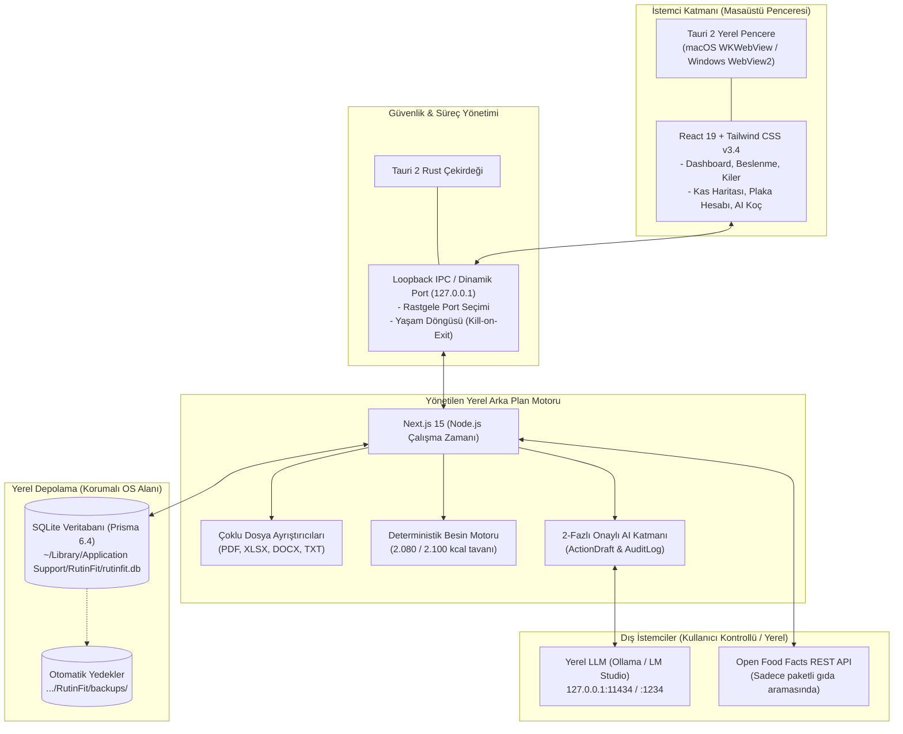

# RutinFit Desktop — Mimari Kararlar ve Teknoloji Yığını Kılavuzu

> **Belge Sürümü:** 1.0  
> **Tarih:** 18 Ekim 2026  
> **Hedef Kitle:** Yazılım Geliştiriciler, Sistem Mimarları ve Katkıda Bulunanlar

Bu belge, **RutinFit Desktop** uygulamasında kullanılan tüm teknolojileri, bu teknolojilerin mimari içindeki rollerini ve **neden bu teknolojilerin seçildiğini** (alternatifleriyle karşılaştırmalı trade-off analizleri eşliğinde) detaylı olarak açıklamaktadır.

---

## 1. Genel Sistem Mimarisi

RutinFit, kişisel sağlık, beslenme ve antrenman verilerinin **%100 yerel bilgisayarda** kalmasını garanti eden, **yerel-first (local-first)** ve sıfır dış bulut bağımlılığı olan bir masaüstü uygulamasıdır.



---

## 2. Kullanılan Teknolojiler ve Seçim Gerekçeleri

### 2.1 Masaüstü Kabuğu: Tauri 2 (Rust)
* **Kullanılan Sürüm:** Tauri `@tauri-apps/cli` v2.12.3 & `@tauri-apps/api` v2.12.4, Rust 1.99.1 (2024 edition).
* **Görev:** İşletim sisteminde yerel pencereyi yönetmek, arka plan süreçlerinin yaşam döngüsünü kontrol etmek ve güvenli IPC sağlamak.

#### Neden Electron Değil de Tauri 2 Seçildi?
| Kriter | Electron | Tauri 2 (Seçilen) | Mimari Gerekçe |
|---|---|---|---|
| **RAM Tüketimi (Boşta)** | 200 – 400 MB | **30 – 60 MB** | RutinFit arka planda sürekli açık kalabilecek bir ritim takipçisidir; minimum bellek ayak izi esastır. |
| **Paket / Kurulum Boyutu** | 120 – 180 MB | **15 – 35 MB** | Electron tam bir Chromium tarayıcısını paketler. Tauri ise işletim sisteminin yerleşik WebView motorunu (macOS WKWebView) kullanır. |
| **Güvenlik Modeli** | Node.js context izolasyon riskleri | **Rust Capabilities & Allowlist** | Renderer sürecinin işletim sistemine yetkisiz erişimi Rust seviyesinde engellenir. |
| **Süreç Yönetimi** | Node tabanlı child_process | **Rust std::process & Signals** | Uygulama kapatıldığında arkada asılı Node süreçlerinin kalmaması Rust sinyalleriyle garanti edilir. |

---

### 2.2 Veritabanı ve ORM: SQLite + Prisma ORM 6
* **Kullanılan Sürüm:** SQLite 3, Prisma ORM v6.4.0.
* **Görev:** Kullanıcı profili, besin kataloğu, yemek planları, egzersiz kayıtları, kiler envanteri, dosya meta verileri ve AI taslaklarının kalıcı olarak saklanması.

#### Neden PostgreSQL, MySQL veya Bulut Veritabanı Değil?
1. **Sıfır Kurulum ve Sıfır Bakım:** PostgreSQL veya MySQL kullanıcının bilgisayarında ayrı bir veritabanı sunucusu, arka plan daemon'u ve port yönetimi gerektirir. SQLite ise uygulama içine gömülü tek bir binary motorudur.
2. **Korumalı Tek Dosya Taşınabilirliği:** Tüm veritabanı tek bir dosyadır (`rutinfit.db`). Bu dosya işletim sisteminin korumalı kullanıcı dizininde tutulur:
   * **macOS:** `~/Library/Application Support/RutinFit/rutinfit.db`
   * **Windows:** `%APPDATA%\RutinFit\rutinfit.db`
   * **Linux:** `~/.local/share/rutinfit/rutinfit.db`
3. **Tek Tıkla Yedekleme ve Taşıma:** Veritabanının yedeğini almak veya başka bir bilgisayara aktarmak, tek bir dosyanın kopyalanması veya JSON dışa aktarımı (`/api/backup/export`) ile saniyeler içinde tamamlanır.
4. **Neden Prisma ORM?** SQLite şemasında TypeScript tip güvenliği, otomatik CUID üretimi, ilişkisel veri bütünlüğü (Cascade Delete) ve güvenli migration yönetimi sağlar.

---

### 2.3 Web & Arka Plan Motoru: Next.js 15 (App Router) + React 19
* **Kullanılan Sürüm:** Next.js v15.2.0 (React 19.0.0, Node.js 22 LTS uyumlu).
* **Görev:** Kullanıcı arayüzü bileşenleri, sunucu taraflı dosya ayrıştırıcıları, REST API rotaları ve yerel veri işleme.

#### Neden Saf React/Vite SPA Değil de Next.js App Router Seçildi?
1. **Hibrit Backend ve Frontend Entegrasyonu:** RutinFit yalnızca bir görsel arayüz değildir; aynı zamanda PDF, Excel ve Word dosyalarını ayrıştıran, yerel AI ile konuşan ve SQLite ile haberleşen bir backend motoruna ihtiyaç duyar. Next.js App Router sayesinde frontend ve 20+ API rotası tek bir standart mimaride birleşmiştir.
2. **Sunucu Taraflı Ağır Kütüphaneler:** `pdf-parse`, `xlsx` ve `mammoth` gibi dosya okuyucu kütüphaneler tarayıcı ortamında hantal kalırken, Next.js sunucu tarafında yüksek hızda ve güvenli bellek alanında çalışır.
3. **React 19 İstemci Optimizasyonu:** Modern Hook'lar, optimize edilmiş re-render döngüleri ve form durumları akıcı bir kullanıcı deneyimi sağlar.

---

### 2.4 Arayüz ve Görselleştirme: Tailwind CSS v3.4 + Recharts + Lucide
* **Tailwind CSS v3.4:**
  * Sıfır çalışma zamanı ek yükü (zero-runtime CSS).
  * Ergonomik tasarım sistemi: Sakin yeşil (`emerald`), odak rengi (`brand-600`), nötr gri (`slate-900`) paleti.
* **Recharts v2.15:**
  * 7 günlük hareketli kilo ortalaması grafiği (`progress/page.tsx`).
  * Enerji seviyesi (1-5) ve uyku süresi korelasyon analizleri.
  * SVG tabanlı, Retina/HiDPI ekranlarda bozulmayan yüksek çözünürlüklü vektör çizimi.
* **Lucide React:**
  * Ağaç budamalı (tree-shakeable), hafif, tutarlı 1000+ ikon kütüphanesi.

---

### 2.5 Deterministik Besin ve İlerleme Motoru (TypeScript)
* **Kaynak:** `src/lib/nutrition-calculator.ts` ve `src/lib/progression.ts`.
* **Görev:** Kalori, protein, karbonhidrat ve yağ hesaplamaları ile antrenman ağırlık artış kuralları.

#### Neden LLM / AI Yerine Deterministik Kod?
* **Halüsinasyon Riski Yoktur:** Bir yapay zeka modeli "150 gram tavuk göğsü kaç kaloridir?" sorusuna her seferinde farklı veya tahmini bir yanıt verebilir.
* **Katı Matematik:** RutinFit'te tüm besin hesaplamaları TÜRKOMP ve USDA onaylı 100g referans değerleri üzerinden şu formülle deterministik olarak yapılır:
  $$\text{Kalori} = \left(\frac{\text{Gram}}{100}\right) \times \text{Referans 100g Kalorisi}$$
* **Çift İlerleme (Double Progression) Kuralı:** Antrenmanda tüm setlerde hedef tekrar üst sınırına (örn. 3×12) ulaşıldığında sistem otomatik olarak deterministik biçimde +2.5 kg artış önerir; aksi halde ağırlığı koruma tavsiyesi verir.

---

### 2.6 Güvenli Yerel Yapay Zeka: Ollama & LM Studio Abstraction
* **Kaynak:** `src/lib/ai-tools/`, `src/lib/ai-schema.ts`, `/api/ai/chat`.
* **Görev:** Kullanıcının beslenme ve antrenman planları hakkında sohbet edebilmesi, yüklenen dosyalardan taslak çıkarması ve öneri alması.

#### Neden Bulut API (OpenAI / Claude) Varsayılan Olarak Seçilmedi?
1. **Sağlık Verisi Gizliliği:** Kullanıcının kilosu, günlük beslenmesi, uyku süresi ve enerji durumu kişisel hassas veridir (KVKK / GDPR). Bu veriler asla üçüncü taraf bir şirketin bulut sunucusuna gönderilmez.
2. **Sıfır Maliyet ve Offline Çalışabilirlik:** Kullanıcı internet bağlantısı olmasa dahi bilgisayarındaki Ollama (`llama3.2`, `qwen2.5`) veya LM Studio modelleriyle koçluk alabilir.
3. **2-Aşamalı Onay (2-Phase Commit Güvenliği):**
   * Yerel model asla doğrudan SQLite veritabanına SQL sorgusu atamaz veya dosya silemez.
   * Model yalnızca Zod ile doğrulanmış bir JSON eylem taslağı (`ActionDraft`) üretir.
   * Kullanıcı arayüzde taslağı görüp onaylamadan hiçbir kalıcı veri değişmez.

---

### 2.7 Çok Formatlı Dosya Ayrıştırma Motoru
* **Kütüphaneler:**
  * **PDF:** `pdf-parse` (v2.4.5)
  * **Excel / CSV:** `xlsx` (v0.18.5)
  * **Word (DOCX):** `mammoth` (v1.13.0)
* **Prompt Injection Savunması:** Dosyalardan çıkarılan tüm metinler sisteme aktarılırken `<untrusted_content>` güvenlik etiketleri içine alınır. Dosyanın içindeki kötü niyetli "önceki talimatları unut" benzeri ifadelerin sistem kurallarını aşması engellenir.

---

### 2.8 Test ve Kalite Güvencesi: Vitest v3
* **Kullanılan Sürüm:** Vitest v3.0.7 (Vite / ESBuild tabanlı).
* **Neden Jest Değil?**
  * Vitest TypeScript ve ESM'i sıfır konfigürasyonla doğrudan çalıştırır.
  * 10 test dosyasındaki 38 birim/entegrasyon testi 700 milisaniye gibi rekor bir sürede tamamlanır.

---

## 3. Teknoloji Seçim Matrisi Özeti

```
┌────────────────────────┬──────────────────────────┬─────────────────────────────┐
│ Kategori               │ Seçilen Teknoloji        │ Tercih Edilmeyen Alternatif │
├────────────────────────┼──────────────────────────┼─────────────────────────────┤
│ Masaüstü Shell         │ Tauri 2 (Rust)           │ Electron (Ağır RAM & Boyut) │
│ Veritabanı             │ SQLite + Prisma 6        │ PostgreSQL / Bulut DB       │
│ Full-Stack Framework   │ Next.js 15 (App Router)  │ Saf Vite SPA                │
│ İstemci Kütüphanesi    │ React 19                 │ Vue / Svelte                │
│ Stil & UI              │ Tailwind CSS v3.4        │ CSS Modules / Styled Comp.  │
│ Grafikler              │ Recharts (SVG)           │ Chart.js (Canvas)           │
│ Yapay Zeka Koçu        │ Yerel Ollama / LM Studio │ OpenAI Cloud (Gizlilik)     │
│ Besin Hesaplayıcı      │ Deterministik TypeScript │ LLM Tahmini (Halüsinasyon)  │
│ Test Motoru            │ Vitest v3                │ Jest (Yavaş Derleme)        │
└────────────────────────┴──────────────────────────┴─────────────────────────────┘
```
